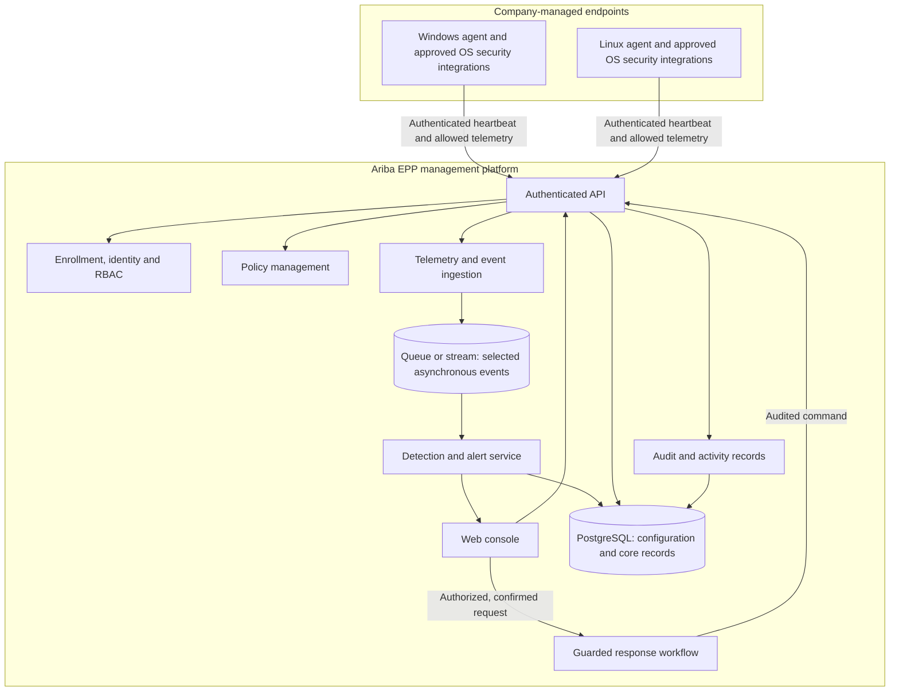

# Ariba EPP — Product Blueprint

**Document status:** Product direction captured; technical decisions require validation  
**Product name:** Ariba EPP — Ariba Enterprise Endpoint Protection Platform  
**Last updated:** 2026-11-09

## 1. Executive summary

Ariba EPP হবে enterprise-এর Windows ও Linux endpoints-এর জন্য centralized management এবং distributed endpoint agents-ভিত্তিক security product। Product direction হলো commercial-grade enterprise platform: নিজস্ব endpoint agent, telemetry pipeline, detection orchestration, policy ও response management থাকবে; mature open-source ও OS security engines integration হিসেবে ব্যবহৃত হবে। Ariba SOC/Wazuh থাকবে integration layer—EPP-এর endpoint identity, management, policy ও detection architecture-এর বিকল্প নয়।

Enterprise production লক্ষ্যটি দীর্ঘমেয়াদি product direction; প্রথমে modular foundation ও lab/pilot evidence দিয়ে ধাপে ধাপে সেখানে পৌঁছাতে হবে। Hybrid approach মানে mature engines integrate করে management, detection orchestration এবং endpoint response capability নিজেরা তৈরি করা। প্রথম সংস্করণকে complete antivirus replacement বলা হবে না; real-time prevention-এর জন্য OS enforcement mechanism, compatibility testing এবং security validation আবশ্যক।

## 2. Product vision and principles

### Vision

Enterprise security team-কে Windows ও Linux endpoints centrally manage, secure, investigate এবং authorizedভাবে respond করতে সক্ষম করা; small deployment থেকে measured horizontal scaling-এ যাওয়ার মতো architecture তৈরি করা।

### Product principles

1. **Security first:** agent, server, update এবং management channel নিরাপদভাবে design করা।
2. **Human-authorized response:** process terminate, quarantine বা network isolation-এর মতো action role/permission, confirmation এবং audit ছাড়া হবে না।
3. **Useful telemetry only:** security-এর জন্য প্রয়োজনীয় data সংগ্রহ; collection, retention এবং access সীমিত ও documented রাখা।
4. **Fail safe:** management server unavailable হলে endpoint protection যেন অপ্রত্যাশিতভাবে বন্ধ বা unsafe state-এ না যায়।
5. **Honest scope:** integration-ভিত্তিক detection-কে নিজস্ব antivirus বা kernel prevention হিসেবে উপস্থাপন করা যাবে না।
6. **Understandable UX:** alert-এর কারণ, impact এবং নিরাপদ next step plain language-এ দেখানো; বাংলা ও English support লক্ষ্য।

## 2.1 Security lifecycle and product objectives

Product lifecycle: **Prevent → Detect → Analyze → Respond → Remediate & Improve**. Prevention, malware protection, endpoint firewall control, application control, behavioral detection, endpoint telemetry এবং incident response EPP-এর intended core capability. Threat hunting is advanced; SIEM is an integration; broad XDR correlation is a future expansion.

Product objectives:

1. Centrally manage Windows and Linux endpoints.
2. Collect endpoint telemetry through lightweight agents.
3. Detect malware, suspicious processes and malicious behavior.
4. Centrally manage endpoint security policies.
5. Investigate threats with process/event timelines.
6. Respond through controlled remote actions.
7. Integrate with Ariba SOC, Wazuh and MISP.
8. Provide enterprise RBAC, audit logging and reporting.
9. Support organizations, sites and departments with tenant-aware authorization.
10. Scale from small deployments toward thousands of endpoints through measurement and horizontal expansion.

Detailed design, component responsibilities, API/data proposals, delivery plan and the initial milestone are documented in [Ariba EPP Enterprise Architecture](ARIBA-EPP-ENTERPRISE-ARCHITECTURE.md).

## 3. Users and primary workflows

### Target users (proposed)

- IT administrator: endpoints enroll ও policy পরিচালনা করেন।
- SOC/security analyst: alert triage, investigation এবং evidence পর্যালোচনা করেন।
- Security administrator: role, access, integrations ও audit records পরিচালনা করেন।

### Main workflow

1. Administrator অনুমোদিত endpoint enroll করেন।
2. Agent inventory, health এবং নির্বাচিত security telemetry report করে।
3. Detection rules বা integrated security tools event থেকে alert তৈরি করে।
4. Analyst alert-এর evidence, endpoint context ও timeline পর্যালোচনা করেন।
5. অনুমোদিত analyst সতর্কতা অনুযায়ী remediation নির্বাচন করেন।
6. Platform action outcome, actor, সময় এবং reason audit log-এ রাখে।

## 4. Proposed product modules

এগুলো long-term product map; সব module MVP-তে থাকবে না।

| Module | উদ্দেশ্য | MVP অবস্থান |
|---|---|---|
| Endpoint Management (EPP-01) | Enrollment, inventory, health, organization/site scope | P0 |
| Agent Management (EPP-02) | Install, upgrade, heartbeat, lifecycle | P0 |
| Telemetry Collection (EPP-03) | Process, file, network and security events | P0 |
| Malware Protection (EPP-04) | YARA/ClamAV integration, hash checks, Defender integration, quarantine workflow | P0, staged and validated |
| Detection Engine (EPP-05) | Versioned rules, correlation, severity and ATT&CK context | P0 |
| Alert Management (EPP-06) | Triage, assignment, investigation, closure | P0 |
| Policy Management (EPP-07) | Versioned security policy, assignment, signed delivery | P0 |
| Incident Response (EPP-08) | Quarantine, process termination, endpoint isolation with approvals | P1 / guarded |
| Vulnerability Management (EPP-09) | Software inventory, CVE context, patch status | P1 |
| Application Control (EPP-10) | Allowlist/blocklist | P1 |
| Network Protection (EPP-11) | Connection monitoring and firewall integration | P1 |
| Threat Intelligence (EPP-12) | IOC management and MISP integration | P1 |
| Reporting (EPP-13) | Compliance, risk and endpoint reports | P2 |
| AI Security Assistant (EPP-14) | Alert explanation and investigation support | P2; never autonomous destructive action |

Priority labels are planning scope: P0 = first production-oriented MVP foundation, P1 = next release, P2 = advanced release. “Production-oriented” does not mean security certification or complete antivirus equivalence.

## 5. MVP proposal

### First delivery foundation

- Windows ও Linux endpoint support; exact supported versions পরে নির্ধারণ করতে হবে।
- Secure enrollment, endpoint identity, heartbeat এবং agent health.
- Basic hardware/software inventory ও last-seen status.
- Policy assignment/read status, initial policy set সীমিত রাখা।
- Security event ingest, basic detection rules and an alert lifecycle; the state machine and transitions await owner approval in ADR-013.
- Alert detail-এ event source, timestamp, endpoint context, severity/reason এবং investigation history.
- RBAC, administrator/analyst roles, audit trail.
- Docker-based development deployment; production topology আলাদা security review ও deployment plan দাবি করে।
- Ariba SOC/Wazuh-এর সাথে integration boundary, event contract এবং response handoff যাচাই।

### Out of scope for first MVP

- নিজস্ব full antivirus engine বা kernel-level prevention system; এগুলো long-term capability/research scope, initial milestone নয়।
- Guaranteed protection from all malware/ransomware.
- Unattended process termination, file deletion বা endpoint isolation.
- Automatic patch deployment, full application allowlisting এবং USB control.
- macOS/mobile support.
- AI-কে autonomous response authority দেওয়া।

### MVP success criteria (targets to agree)

- Test lab-এর enrolled endpoints console-এ identifiable, healthy/unhealthy এবং last-seen state-সহ দেখা যায়।
- Test event end-to-end ingest হয়ে traceable alert তৈরি করে।
- RBAC unauthorized user-কে restricted action থেকে বাধা দেয়।
- Alert-এর response action হলে কে, কখন, কেন করেছে এবং ফলাফল কী—তা audit করা যায়।
- Agent/server disconnect ও reconnect-এর ক্ষেত্রে documented, predictable behavior থাকে।
- কোনো disruptive action production endpoint-এ চালু করার আগে test, authorization এবং rollback procedure আছে।

## 6. Proposed architecture

এটি logical design proposal, বর্তমান repository implementation-এর বর্ণনা নয়।



### Component responsibilities

- **Endpoint agent:** endpoint identity, heartbeat, minimal approved inventory/telemetry, policy retrieval and authenticated command handling. Avoid collecting unrelated personal content.
- **API and identity:** authenticate users/agents, enforce tenant and role boundaries, validate requests and rate limits.
- **Policy service:** versioned policy, assignment, acknowledgement and rollback metadata.
- **Ingestion/detection:** validate event schema, normalize source metadata, apply versioned rules and retain evidence references.
- **Response workflow:** explicit authorization, confirmation, expiry/target checks, action status and audit. Default deny for unsupported or risky actions.
- **Console:** endpoint posture, alerts, investigations, policy status, integrations and audit search.
- **Storage/queue:** PostgreSQL is a proposed source for core records. Redis Streams/RabbitMQ are options to evaluate for event delivery; select only after throughput, reliability and operational needs are known.

## 7. Technology direction (proposed, not selected)

| Area | Candidate direction | Decision notes |
|---|---|---|
| Web console | Existing Ariba SOC frontend, or React/Next.js if a separate UI is needed | Inspect actual codebase before choosing |
| API/backend | Existing backend where possible; Python/FastAPI is one candidate | Avoid introducing a second stack without a reason |
| Core data | PostgreSQL | Tenant boundaries, retention, migrations and audit requirements need design |
| Cache / short-lived state | Redis | Not automatically the durable event store |
| Event transport | Redis Streams or RabbitMQ | Prototype and compare delivery/retry/operations needs |
| Endpoint visibility | OS-supported security interfaces and tools such as Sysmon/osquery/auditd, subject to compatibility review | Integrate; do not imply these alone provide full prevention |
| File scanning | Existing Defender/ClamAV/YARA-based integrations may be evaluated | Licensing, coverage, performance and safe test corpus require validation |
| SOC/SIEM | Wazuh/OpenSearch integration is a candidate | Verify current deployment, APIs, schemas and ownership before coupling |
| Deployment | Docker Compose for development; hardened deployment design for production | Secrets, TLS, backups, upgrades and least privilege are required |

## 8. Security, privacy and operational safeguards

- Agent-to-server and user-to-server communication must use authenticated encrypted channels; mutual TLS is a candidate for agent identity.
- Enrollment credentials must be short-lived or single-use where practical; revoke and rotate credentials safely.
- Agent binaries, policies and updates require integrity/authenticity verification and a controlled signing/release process.
- Enforce tenant separation, least privilege, role checks and server-side authorization on every action.
- Record immutable or tamper-evident audit events for policy and response changes; avoid logging secrets or unnecessary personal data.
- Define telemetry categories, retention limits, access controls, deletion processes and user/company notice before pilot rollout.
- Quarantine and evidence handling need access controls, integrity metadata, retention and restore procedures.
- Response actions must include target validation, permission checks, confirmation, timeout/expiry, result reporting and rollback/escalation guidance.
- Test only on owned/authorized endpoints and an isolated lab. Start in observe-only mode; gradually enable guarded actions after validation.
- Establish agent update rollback, server backup/restore, incident response, monitoring and vulnerability patch processes before production use.

## 9. Dashboard information architecture

Proposed navigation:

- Overview
- Endpoints
- Alerts / Threat Detection
- Investigations / Incidents
- Policies
- Integrations
- Audit Log
- Administration

Overview cards may show total, protected, online and alert counts. Any sample such as “850 endpoints” is illustrative only and must never be shown as live data unless sourced from actual telemetry. Pages should handle loading, empty, stale, permission-denied and partial-connection states explicitly.

## 10. Development roadmap

Order below is a proposed delivery direction; dates and estimates remain planning estimates until team capacity and acceptance tests are confirmed. The sole detailed M0–M10 implementation checklist is [Project Task List](PROJECT-TASKS.md); the docs approval gate is in [Implementation Plan](IMPLEMENTATION-PLAN.md).

| Phase | Deliverable | Exit evidence |
|---|---|---|
| 0 — Discovery | Inspect existing Ariba SOC stack, users, Wazuh integration possibilities, target OS and privacy needs | Confirmed scope, integration inventory, threat model and architecture decisions |
| 1 — Platform foundation | Authentication/RBAC, endpoint identity/enrollment, basic console shell and audit model | Role tests, enrollment/revocation tests and documented API contracts |
| 2 — Endpoint visibility | Windows/Linux heartbeat, health and basic inventory | Lab endpoints display correct status; disconnect/reconnect behavior tested |
| 3 — Events and alerts | Versioned event schema, ingestion, basic rules, alert lifecycle | Synthetic safe test events produce explainable and traceable alerts |
| 4 — Policy and integration | Policy assignment/status and selected existing security-tool integration | Compatibility, failure and rollback tests pass |
| 5 — Guarded response | Limited, explicit, auditable action(s), initially lab-only | Authorization, confirmation, outcome, timeout and rollback tests pass |
| 6 — Pilot hardening | Performance, privacy, reliability, update/backup and operational reviews | Pilot checklist, support/rollback plan and known-limitations document approved |
| Later | Vulnerability context, application/device control, threat intel, macOS/mobile, AI assistance | Separate product decision and acceptance criteria per capability |

## 11. Suggested repository documentation/code layout

This is a future organization proposal, not a claim that these directories already exist.

```text
docs/
  README.md
  ARIBA-EPP-BLUEPRINT.md
  architecture/       # detailed design and decisions, when needed
  api/                # API contracts, when implemented
  operations/         # deployment, backup, upgrade and incident runbooks
  security/           # threat model, data handling and response safeguards
  testing/            # lab setup, test plans and release evidence

frontend/             # use/adapt existing SOC frontend if appropriate
backend/              # API and platform services
endpoint-agent/       # OS-specific agent implementations
integrations/         # SOC/SIEM/security-tool adapters
deployment/           # development and production deployment assets
```

## 12. Open decisions

1. Is “Ariba EPP” the final product name, and is the first audience internal SOC users or external customers?
2. Which Windows and Linux versions/distributions must the first pilot support?
3. Should EPP be a module in the existing Ariba SOC, a separate service, or both over time?
4. Which current SOC components and interfaces are confirmed available for reuse?
5. What endpoint volume, event volume, retention period and availability target should the MVP support?
6. Which telemetry is acceptable to collect, and what are the tenant/data residency requirements?
7. Which detection/scanning integrations are approved, licensed and supportable?
8. Which response action, if any, is required in the first pilot? Should MVP remain observe-only?
9. Which provider/region, data residency and production topology should the centrally hosted multi-organization platform use (the hosted model is approved in ADR-009)?
10. Which languages are required for the initial console and alert explanations (Bangla, English, or both)?

## 13. Source and confidence notes

- Product capabilities and proposed module list are based on the user's supplied concept.
- The recommendation to begin with a hybrid, limited Windows/Linux MVP and avoid claiming a custom antivirus engine is a planning recommendation from this discussion.
- Architecture and stack entries are candidates only; they need repository inspection, compatibility tests, security review and product-owner approval.
- No market-size, competitor, performance, detection-coverage or compliance claims are made in this blueprint.