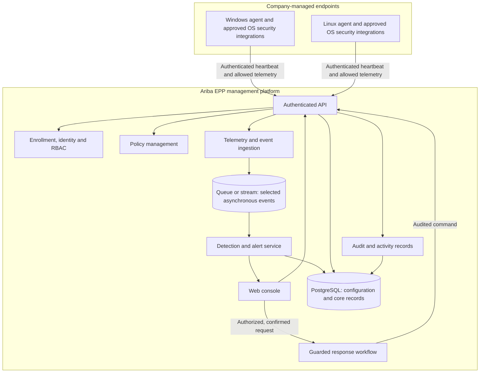

# Ariba EPP — Product Blueprint

**Document status:** Product direction captured; technical decisions require validation  
**Product name:** Ariba EPP — Ariba Enterprise Endpoint Protection Platform  
**Last updated:** 2026-11-10

## 1. Executive summary

Ariba EPP হবে enterprise-এর Windows ও Linux endpoints-এর জন্য centralized management এবং distributed endpoint agents-ভিত্তিক security product। Product direction হলো enterprise platform: নিজস্ব endpoint agent, telemetry pipeline, detection orchestration, policy ও response management থাকবে; mature open-source ও OS security engines integration হিসেবে ব্যবহৃত হবে। Ariba SOC/Wazuh থাকবে integration layer—EPP-এর endpoint identity, management, policy ও detection architecture-এর বিকল্প নয়। Product structure হলো Platform → Parent Group (`organization_id`) → Company (`company_id`) → Site (`site_id`) → Endpoint.

Enterprise production লক্ষ্যটি দীর্ঘমেয়াদি product direction; প্রথমে modular foundation ও lab/pilot evidence দিয়ে ধাপে ধাপে সেখানে পৌঁছাতে হবে। Hybrid approach মানে mature engines integrate করে management, detection orchestration এবং endpoint response capability নিজেরা তৈরি করা। প্রথম সংস্করণকে complete antivirus replacement বলা হবে না; real-time prevention-এর জন্য OS enforcement mechanism, compatibility testing এবং security validation আবশ্যক।

## 2. Product vision and principles

### Vision

Enterprise security team-কে Windows ও Linux endpoints centrally manage, secure, investigate এবং authorizedভাবে respond করতে সক্ষম করা; small deployment থেকে measured horizontal scaling-এ যাওয়ার মতো architecture তৈরি করা।

### Product principles

1. **Security first:** agent, server, update এবং management channel নিরাপদভাবে design করা।
2. **Human-authorized response:** process terminate, quarantine বা network isolation-এর মতো action role/permission, confirmation এবং audit ছাড়া হবে না।
3. **Useful telemetry only:** security-এর জন্য প্রয়োজনীয় data সংগ্রহ; collection, retention এবং access সীমিত ও documented রাখা।
4. **Fail safe:** management server unavailable হলে endpoint protection যেন অপ্রত্যাশিতভাবে বন্ধ বা unsafe state-এ না যায়।
5. **Honest scope:** integration-ভিত্তিক detection-কে নিজস্ব antivirus বা kernel prevention হিসেবে উপস্থাপন করা যাবে না।
6. **Understandable UX:** alert-এর কারণ, impact এবং নিরাপদ next step plain language-এ দেখানো; বাংলা ও English support লক্ষ্য।

## 2.1 Security lifecycle and product objectives

Product lifecycle: **Prevent → Detect → Analyze → Respond → Remediate & Improve**. Prevention, malware protection, endpoint firewall control, application control, behavioral detection, endpoint telemetry এবং incident response EPP-এর intended core capability. Threat hunting is advanced; SIEM is an integration; broad XDR correlation is a future expansion.

Product objectives:

1. Centrally manage Windows and Linux endpoints.
2. Collect endpoint telemetry through lightweight agents.
3. Detect malware, suspicious processes and malicious behavior.
4. Centrally manage endpoint security policies.
5. Investigate threats with process/event timelines.
6. Respond through controlled remote actions.
7. Integrate with Ariba SOC, Wazuh and MISP.
8. Provide enterprise RBAC, audit logging and reporting.
9. Support organizations, sites and departments with tenant-aware authorization.
10. Scale from small deployments toward thousands of endpoints through measurement and horizontal expansion.

Detailed design, component responsibilities, API/data proposals, delivery plan and the initial milestone are documented in [Ariba EPP Enterprise Architecture](ARIBA-EPP-ENTERPRISE-ARCHITECTURE.md).

## 3. Users and primary workflows

### Target users (role families confirmed; exact grants pending)

- Platform Super Admin: platform operations and Parent Group onboarding.
- Group Administrator / Group SOC Lead: Group administration or Group-level SOC rollups.
- Company Administrator / Company SOC Analyst: own Company administration or SOC work.
- Unit / Site Administrator: local site operations.
- Security Administrator, Security Auditor and Executive Viewer: assigned scope only.

Exact role grants remain **Proposed/To confirm** in [RBAC & Hierarchical Permission Matrix](security/PERMISSION-MATRIX.md); no grant is active until approved.

### Main workflow

1. Administrator অনুমোদিত endpoint enroll করেন।
2. Agent inventory, health এবং নির্বাচিত security telemetry report করে।
3. Detection rules বা integrated security tools event থেকে alert তৈরি করে।
4. Analyst alert-এর evidence, endpoint context ও timeline পর্যালোচনা করেন।
5. অনুমোদিত analyst সতর্কতা অনুযায়ী remediation নির্বাচন করেন।
6. Platform action outcome, actor, সময় এবং reason audit log-এ রাখে।

## 4. Proposed product modules

এগুলো owner-confirmed release map-এর সংক্ষিপ্ত রূপ; detail ও acceptance `PRODUCT-REQUIREMENTS.md`-এ authoritative।

| Module | উদ্দেশ্য | Release status |
|---|---|---|
| Endpoint & Agent Management (EPP-01/02) | Enrollment, inventory, health, lifecycle | Release 1; first proven subset is Foundation v0.1 |
| Process & File Telemetry (EPP-03) | Approved process/file event collection and SHA256 metadata | Release 1; network telemetry is not included in the current matrix |
| Malware Scanning (EPP-04) | YARA/ClamAV/native protection integration | Release 1; no full AV replacement claim |
| Detection, Alerts & Policy (EPP-05/06/07) | Versioned detections, alert workflow and signed policy | Release 1; alert states depend on ADR-013 |
| Quarantine & Guarded Response (EPP-08) | Action-specific approved response | Release 2; ADR-014/action review required; no destructive control by default |
| Ransomware / Host Firewall / Application Control | Additional endpoint prevention/control | Release 2; platform support and tests required |
| Vulnerability Management (EPP-09) | Inventory, CVE context and risk scoring | Release 2 |
| Threat Intelligence (EPP-12) | IOC/MISP integration | Release 2 candidate; provenance/licensing review |
| Incident Cases | Separate case workflow beyond alert investigation | To confirm; do not assume Release 1 |
| Reporting (EPP-13) | Executive/compliance reports | To confirm; no compliance claim without evidence |
| AI Assistant / Advanced Hunting (EPP-14) | Explain/assist or query historical telemetry | Release 3; no autonomous response |

Release status follows the owner-confirmed feature matrix in `PRODUCT-REQUIREMENTS.md`; each capability still requires implementation evidence and acceptance tests. Dashboard visibility is governed by `docs/dashboard/README.md`.

## 5. Foundation v0.1 and Release 1 scope

### Proposed Foundation v0.1 — first proof (roadmap M0–M2; owner freeze required)

- Proposed login/admin shell and parent Group → Company → Site basics; exact login/MFA scope and administration surfaces remain To confirm, and role grants require permission-matrix approval.
- Short-lived one-time enrollment, unique agent identity, heartbeat, basic inventory and online/stale status for one owned Windows and one owned Linux lab endpoint.
- Audit evidence for enrollment and hierarchy changes.
- Repeatable local/lab deployment only; Docker Compose is not a production topology.
- Telemetry pipeline, detection rules, malware scanning, alert lifecycle and policy rollout are not part of this proof milestone.

**Foundation success:** both lab endpoints enroll with unique identities under the correct Group/Company/Site and their heartbeat/last-seen state appears in the authorized console. This does not demonstrate Release 1 detection or prevention.

### Release 1 — owner-confirmed feature matrix (M3–M5)

- Process/file telemetry and malware-scanning integrations within the approved OS/field scope.
- Versioned detection rules and explainable alert management; alert transitions remain subject to ADR-013.
- Signed/versioned policy distribution and acknowledgement, after signing authority and permission decisions are approved.
- Release 1 integration specifics, supported OS builds, telemetry fields and acceptance tests must be confirmed before their implementation tasks.

### Out of scope for Foundation v0.1

- নিজস্ব full antivirus engine বা kernel-level prevention system; এগুলো long-term capability/research scope, initial milestone নয়।
- Guaranteed protection from all malware/ransomware.
- Unattended process termination, file deletion বা endpoint isolation.
- Automatic patch deployment, full application allowlisting এবং USB control.
- macOS/mobile support.
- AI-কে autonomous response authority দেওয়া।

### Foundation v0.1 acceptance criteria (targets to approve)

- One authorized Windows and one authorized Linux lab agent enroll with unique identities and correct Group/Company/Site binding.
- Invalid, expired, reused and revoked enrollment tokens are rejected.
- Authorized users see only their approved hierarchy scope; cross-Group/Company/Site tests fail closed.
- Console shows real endpoint identity, OS/agent version, health and last-seen data; no fabricated values.
- Agent/server disconnect and reconnect behavior is documented and testable.
- Enrollment/admin changes are auditable without secrets or unnecessary personal data.
- Local/lab setup works without production credentials; no production response action is present.

Release 1 has separate acceptance criteria in `PRODUCT-REQUIREMENTS.md` and `TEST-STRATEGY.md`; do not use Release 1 detection tests as Foundation v0.1 evidence.

## 6. Proposed architecture

এটি logical design proposal, বর্তমান repository implementation-এর বর্ণনা নয়।



### Component responsibilities

- **Endpoint agent:** endpoint identity, heartbeat, minimal approved inventory/telemetry, policy retrieval and authenticated command handling. Avoid collecting unrelated personal content.
- **API and identity:** authenticate users/agents, enforce tenant and role boundaries, validate requests and rate limits.
- **Policy service:** versioned policy, assignment, acknowledgement and rollback metadata.
- **Ingestion/detection:** validate event schema, normalize source metadata, apply versioned rules and retain evidence references.
- **Response workflow:** explicit authorization, confirmation, expiry/target checks, action status and audit. Default deny for unsupported or risky actions.
- **Console:** endpoint posture, alerts, investigations, policy status, integrations and audit search.
- **Storage/queue:** PostgreSQL is a proposed source for core records. Redis Streams/RabbitMQ are options to evaluate for event delivery; select only after throughput, reliability and operational needs are known.

## 7. Technology direction (proposed, not selected)

| Area | Candidate direction | Decision notes |
|---|---|---|
| Web console | Existing Ariba SOC frontend, or React/Next.js if a separate UI is needed | Inspect actual codebase before choosing |
| API/backend | Existing backend where possible; Python/FastAPI is one candidate | Avoid introducing a second stack without a reason |
| Core data | PostgreSQL | Tenant boundaries, retention, migrations and audit requirements need design |
| Cache / short-lived state | Redis | Not automatically the durable event store |
| Event transport | Redis Streams or RabbitMQ | Prototype and compare delivery/retry/operations needs |
| Endpoint visibility | OS-supported security interfaces and tools such as Sysmon/osquery/auditd, subject to compatibility review | Integrate; do not imply these alone provide full prevention |
| File scanning | Existing Defender/ClamAV/YARA-based integrations may be evaluated | Licensing, coverage, performance and safe test corpus require validation |
| SOC/SIEM | Wazuh/OpenSearch integration is a candidate | Verify current deployment, APIs, schemas and ownership before coupling |
| Deployment | Docker Compose for development; hardened deployment design for production | Secrets, TLS, backups, upgrades and least privilege are required |

## 8. Security, privacy and operational safeguards

- Agent-to-server and user-to-server communication must use authenticated encrypted channels; mutual TLS is a candidate for agent identity.
- Enrollment credentials must be short-lived or single-use where practical; revoke and rotate credentials safely.
- Agent binaries, policies and updates require integrity/authenticity verification and a controlled signing/release process.
- Enforce tenant separation, least privilege, role checks and server-side authorization on every action.
- Record immutable or tamper-evident audit events for policy and response changes; avoid logging secrets or unnecessary personal data.
- Define telemetry categories, retention limits, access controls, deletion processes and user/company notice before pilot rollout.
- Quarantine and evidence handling need access controls, integrity metadata, retention and restore procedures.
- Response actions must include target validation, permission checks, confirmation, timeout/expiry, result reporting and rollback/escalation guidance.
- Test only on owned/authorized endpoints and an isolated lab. Start in observe-only mode; gradually enable guarded actions after validation.
- Establish agent update rollback, server backup/restore, incident response, monitoring and vulnerability patch processes before production use.

## 9. Dashboard information architecture

Proposed navigation:

- Overview
- Endpoints
- Alerts / Threat Detection
- Investigations / Incidents
- Policies
- Integrations
- Audit Log
- Administration

Overview cards may show total, protected, online and alert counts. Any sample such as “850 endpoints” is illustrative only and must never be shown as live data unless sourced from actual telemetry. Pages should handle loading, empty, stale, permission-denied and partial-connection states explicitly.

## 10. Development roadmap

Order below is a proposed delivery direction; dates and estimates remain planning estimates until team capacity and acceptance tests are confirmed. The sole detailed M0–M10 implementation checklist is [Project Task List](PROJECT-TASKS.md); the docs approval gate is in [Implementation Plan](IMPLEMENTATION-PLAN.md).

| Phase | Deliverable | Exit evidence |
|---|---|---|
| Docs gate | Owner review of scope, hierarchy RBAC, OS support, privacy and component contracts | Decisions recorded; no blocking conflict; selected milestone approved |
| Proposed Foundation v0.1 (M0–M2; owner freeze required) | Candidate login/admin shell, Group/Company/Site basics, enrollment, heartbeat and basic inventory; exact login/MFA and admin surfaces To confirm | After owner scope approval: one authorized Windows and one Linux lab endpoint visible in correct scope |
| Release 1 (M3–M5) | Process/file telemetry, malware scanning, detection/alerts and signed policy | Synthetic test event→traceable alert; scanner/policy evidence; no disruptive response |
| Release 2 feature work (M6–M8) | Approved guarded action(s), ransomware/firewall, vulnerability/app control and integrations | Each feature separately approved, lab-tested, audited and recoverable |
| Release readiness (M9–M10) | Hardening, signed packaging, backup/restore, operations and any approved pilot | Release-gate evidence, pilot approval and rollback/support plan; deployment topology per ADR-008 |
| Release 3 | AI explanation and advanced threat hunting | Separate requirements and safety review; no autonomous destructive action |

Dates and staffing estimates remain planning-only. `PROJECT-TASKS.md` is the sole detailed execution ledger.

## 11. Suggested repository documentation/code layout

This is a future organization proposal, not a claim that these directories already exist.

```text
docs/
  README.md
  ARIBA-EPP-BLUEPRINT.md
  architecture/       # detailed design and decisions, when needed
  api/                # API contracts, when implemented
  operations/         # deployment, backup, upgrade and incident runbooks
  security/           # threat model, data handling and response safeguards
  testing/            # lab setup, test plans and release evidence

frontend/             # use/adapt existing SOC frontend if appropriate
backend/              # API and platform services
endpoint-agent/       # OS-specific agent implementations
integrations/         # SOC/SIEM/security-tool adapters
deployment/           # development and production deployment assets
```

## 12. Open decisions

1. Is “Ariba EPP” the final product name, and which customer Groups are authorized for the first pilot?
2. Which Windows and Linux versions/distributions must the first pilot support?
3. What API/event, identity and response-request contracts should connect the separate EPP control plane with Ariba SOC/Wazuh?
4. Which existing SOC components/interfaces are confirmed integration targets, and which remain candidates only?
5. What endpoint volume, event volume, retention period and availability target should Release 1 support?
6. Which telemetry is acceptable to collect, and what are the tenant/data residency requirements?
7. Which detection/scanning integrations are approved, licensed and supportable?
8. What exact Group/Company/Site permission grants are approved in the RBAC matrix, and what roles may see Company-level alert evidence?
9. Is a standalone incident-case workflow included in Release 1, or is the first scope alert investigation only?
10. Which response action, if any, is selected for Release 2/pilot, and what approval/recovery rules apply? Observe-only remains default until ADR-014/action review.
11. Which provider/region, data residency and production topology should the centrally hosted platform use (hosting model is approved in ADR-009)?
12. Which languages are required for the initial console and alert explanations (Bangla, English, or both)?

## 13. Source and confidence notes

- Product capabilities and proposed module list are based on the user's supplied concept.
- The recommendation to begin with a hybrid, limited Windows/Linux MVP and avoid claiming a custom antivirus engine is a planning recommendation from this discussion.
- Architecture and stack entries are candidates only; they need repository inspection, compatibility tests, security review and product-owner approval.
- No market-size, competitor, performance, detection-coverage or compliance claims are made in this blueprint.