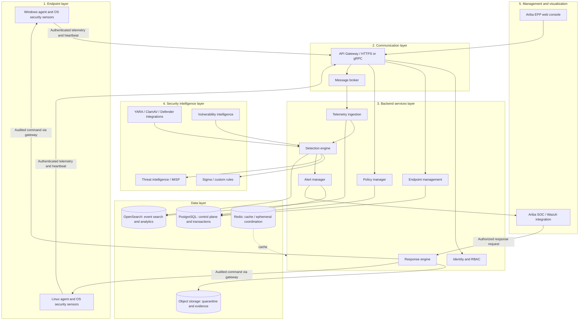
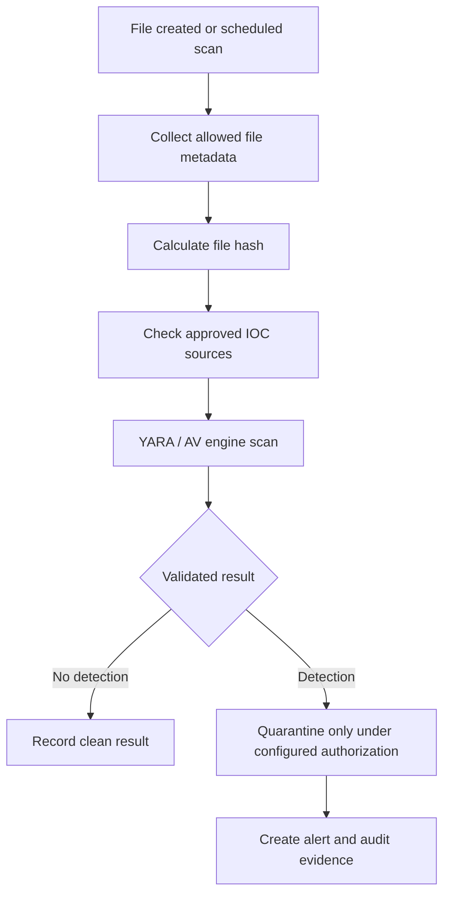

# Ariba EPP — Enterprise Architecture and Engineering Blueprint

**Product:** Ariba EPP — Ariba Enterprise Endpoint Protection Platform  
**Direction:** Enterprise security product; hybrid architecture; Windows + Linux  
**Document status:** Product direction captured; implementation details and technology choices require validation
**Updated:** 2026-11-10

> This is a product and architecture plan, not a claim that the features are implemented, production-certified, or equivalent to a mature commercial antivirus. “Adopt” in the supplied concept is treated as a proposed baseline until repository review, compatibility checks, security review, licensing review and measurements are complete.

## 1. Product vision and boundaries

Ariba EPP is a centralized endpoint protection platform with distributed endpoint agents. It will own endpoint identity and lifecycle, policy management, telemetry pipeline, detection orchestration, alerts, and controlled endpoint response. Open-source engines and native OS security capabilities provide integrations; Ariba SOC/Wazuh and MISP are integrations, not substitutes for EPP's own control plane.

### Security lifecycle

**Prevent → Detect → Analyze → Respond → Remediate & Improve**

- **Prevent:** malware protection, policy enforcement, application control and host firewall integrations.
- **Detect:** process, file, network and behavioral signals.
- **Analyze:** event context, correlation, threat intelligence and MITRE ATT&CK mapping.
- **Respond:** authorized quarantine, process termination or endpoint isolation.
- **Remediate & improve:** restore, patch, validate recovery and improve tested rules.

### Product objectives

1. Centrally manage Windows and Linux endpoints through lightweight agents.
2. Detect malware, suspicious processes and behaviors; make alerts explainable and traceable.
3. Manage centrally assigned endpoint policies and their version/acknowledgement state.
4. Investigate with endpoint context and process/event timelines.
5. Execute controlled, authorized response and record results.
6. Integrate with Ariba SOC, Wazuh, MISP and selected security engines.
7. Provide tenant-aware RBAC, audit, reporting and organization/site/department structure.
8. Scale from small deployments toward thousands of endpoints based on measured event rate, retention and availability requirements.

### Capability boundary

| Capability | Ariba EPP direction |
|---|---|
| Antivirus and malware prevention | Core product goal; initially integrate mature engines and native protection, do not claim a new full AV engine |
| Endpoint firewall and application control | Core product goal, delivered through tested platform integrations and policy |
| Behavioral detection and endpoint telemetry | Core product capability |
| Incident response | Core capability with authorization, approval and audit safeguards |
| Threat hunting | Advanced capability |
| SIEM | Integration; Ariba SOC/Wazuh can consume EPP events |
| Broad XDR correlation | Future expansion |

## 2. System architecture

The system has five logical layers: endpoint, communication, backend services, security intelligence, and management/visualization.



### Architecture rules

- Begin with a **modular monolith** for management/control-plane services and separately scalable ingestion/detection workers. Do not start with a large microservice fleet.
- PostgreSQL is for transactional/control-plane records. Do not put an unbounded volume of raw telemetry in PostgreSQL JSON columns.
- OpenSearch or another measured event store handles high-volume event search/analytics. Object storage holds controlled forensic artifacts and quarantine objects.
- Redis is for cache and ephemeral coordination, not the only copy of durable security evidence.
- Keep EPP identity, endpoint lifecycle, policy and detections independent from the Ariba SOC/Wazuh integration contract.
- Separate data plane, management plane and privileged response paths; restrict network paths and service permissions.

### Main component responsibilities

| Component | Responsibility |
|---|---|
| Endpoint agent | Collect approved telemetry, report health, receive policy and handle authorized commands |
| API gateway | Authentication, routing, request limits and API boundary validation |
| Message broker | Asynchronous event delivery, retry and backpressure |
| Endpoint manager | Enrollment, inventory, lifecycle and status |
| Policy manager | Policy authoring/versioning, assignment, signing and acknowledgement |
| Detection engine | Normalize/enrich events, evaluate rules, correlate and generate explainable alerts |
| Alert manager | Alert lifecycle, assignment, notifications and closure |
| Response engine | Authorization, approval, command execution tracking and safe recovery |
| PostgreSQL | Tenant, identity, configuration, policy, alert metadata and audit/control records |
| OpenSearch | High-volume event search, analytics and investigation timeline |
| Object storage | Restricted quarantine files and forensic artifacts |
| EPP console | Endpoint posture, policy, alerts, investigations, response and administration |
| Ariba SOC/Wazuh | Cross-source correlation, SOC workflow and SIEM visibility through defined integration |

## 3. Functional modules and priorities

Release status follows the owner-confirmed matrix in [`PRODUCT-REQUIREMENTS.md`](PRODUCT-REQUIREMENTS.md). This module list maps the original EPP module IDs to that release plan; it is not a second release authority. Individual features still require staged implementation, test evidence and acceptance criteria.

| ID | Module | Main scope | Release status |
|---|---|---|---|
| EPP-01 | Endpoint Management | Enrollment, inventory, health and status | Release 1; Foundation v0.1 proves a minimal subset |
| EPP-02 | Agent Management | Installation, upgrade, heartbeat and lifecycle | Release 1; Foundation v0.1 proves identity/heartbeat subset |
| EPP-03 | Telemetry Collection | Process and file telemetry per approved field allowlist | Release 1 |
| EPP-04 | Malware Scanning | YARA/ClamAV/native protection integration | Release 1; quarantine is separate Release 2 scope |
| EPP-05 | Detection Engine | Versioned rules, correlation and severity | Release 1 |
| EPP-06 | Alert Management | Triage and investigation; state machine per ADR-013 | Release 1; separate incident-case lifecycle To confirm |
| EPP-07 | Policy Management | Signed/versioned policy assignment and acknowledgement | Release 1; signing authority/SoD decisions required |
| EPP-08 | Quarantine / Guarded Response | Action-specific quarantine or response workflow | Release 2; ADR-014 and action approval required |
| EPP-09 | Vulnerability Management | CVE context and software inventory | Release 2 |
| EPP-10 | Application Control | Allowlist/blocklist | Release 2 |
| EPP-11 | Network Protection | Host firewall and network isolation | Release 2; platform support/recovery tests required |
| EPP-12 | Threat Intelligence | IOC lifecycle and MISP integration | Release 2 candidate; validate source/licensing |
| EPP-13 | Reporting | Executive/compliance reports | To confirm; no compliance claim without approved evidence |
| EPP-14 | AI Security Assistant | Alert explanation and investigation support | Release 3; no autonomous destructive action |

## 4. Endpoint management and agent

Two native agents are planned: **Ariba Agent for Windows** and **Ariba Agent for Linux**. The agent is a critical, privileged security component and needs a narrow, reviewable feature set.

### Endpoint inventory fields (proposed)

- Endpoint ID, hostname, platform, OS/version, agent/version, IP and MAC address.
- Parent Group (`organization_id`), Company (`company_id`), Site (`site_id`), department and assigned user where policy permits.
- Last seen, agent health, policy version/acknowledgement, protection status and risk context.

Example data only:

```json
{
  "hostname": "ORG-WS-001",
  "platform": "windows",
  "os_version": "Windows 11",
  "agent_version": "1.0.0",
  "department": "IT",
  "location": "Head Office",
  "protection_status": "protected"
}
```

The values are illustrative and are not actual endpoint data.

### Agent technology candidates

| Agent area | Candidate |
|---|---|
| Agent core | Go |
| Windows process/security events | ETW and Windows Event Log |
| Linux process/security events | auditd and/or osquery, subject to supported distro tests |
| File monitoring | OS-native file notification APIs |
| Scanning integrations | YARA/ClamAV and Microsoft Defender integration where supported |
| Communication | HTTPS initially; gRPC may be evaluated |
| Serialization | Protocol Buffers candidate; schema/version strategy required |
| Local configuration | YAML candidate with secure permissions and validation |
| Offline queue | SQLite candidate with bounded capacity and data-protection review |
| Packaging | MSI for Windows; DEB/RPM for supported Linux distributions |

Use native OS-specific collectors where required; do not pretend all telemetry semantics are portable across platforms.

### Agent source layout proposal

```text
agent/
├── cmd/ariba-agent/
├── internal/
│   ├── config/ enrollment/ heartbeat/
│   ├── collectors/{system,process,file,network,security}/
│   ├── normalizer/ queue/ transport/ policy/ response/
│   ├── updater/ logging/
├── platform/{windows,linux}/
├── packaging/{windows-msi,linux-deb,linux-rpm}/
└── tests/
```

### Agent operational requirements

1. Unique endpoint identity and certificate-based agent authentication; mutual TLS is the proposed baseline.
2. Short-lived, one-time enrollment token; defined renewal, rotation, revocation and recovery.
3. Signed agent binaries, update packages and policy bundles; verify signatures before use.
4. Secure local configuration; encrypt sensitive local queue data if it contains sensitive material.
5. Bounded queue, backpressure, idempotency and retry with exponential backoff.
6. Resource and disk budgets, observable agent health, and tested upgrade rollback.
7. Tamper protection designed with safe administration, authorized uninstall and recovery workflows.
8. Predictable behavior on offline server/network, partial update and command expiry.
9. Secure uninstall and recovery procedures; do not disable existing antivirus protection.
10. Measure performance on representative hardware. The suggested initial target of roughly 1–3% average CPU under normal telemetry is a **planning target**, not a guarantee; scan workloads need separate configurable budgets and measurement.

## 5. Malware protection and response

### Malware integration direction

Use mature engines rather than claiming an antivirus engine has been created from scratch. Candidate technologies are YARA rules, ClamAV, Microsoft Defender integration on Windows, hash/IOC matching and a restricted quarantine service. Validate coverage, licensing, performance, platform support, rule provenance and false positives before release.

Illustrative scan flow:



**Important:** a file-monitoring event alone does not prevent execution. Real-time prevention requires a tested OS enforcement mechanism. Integrate with existing protection initially and do not disable it. Use EICAR or another benign, approved test artifact in an isolated lab for initial scanner integration validation; do not begin with live malware.

### Controlled response actions

| Action | Guardrail |
|---|---|
| Kill process | Target must be revalidated; permission/approval, reason, result and audit required |
| Quarantine file | Verify endpoint, file identity/hash, storage access, retention and restore path |
| Isolate endpoint | Preserve a narrowly scoped secure management/recovery channel; provide release/recovery process |
| Restore file | Require authorized approval and verify the quarantined object/integrity |
| Collect evidence | Minimize collection; define allowed paths/data, access and retention |
| Run scan | Explicit scope and resource policy; report completion and failures |
| Release endpoint | Require authorized approval and log restored network state |

All response requests must be authenticated, authorized, attributable and traceable. Risky actions need explicit approval and target validation. Do not grant the AI assistant autonomous destructive authority.

## 6. Detection, event schema and threat intelligence

### Detection pipeline

```text
Endpoint event → Schema validation → Normalization → Context enrichment
→ Rule evaluation → Correlation → Explainable risk/severity → Alert
→ Investigation and approved response
```

Use ECS-compatible field conventions where useful, with a documented, versioned Ariba event schema. Capture event time and ingestion time, source/agent version, endpoint identity, schema version and rule provenance. Enforce tenant/endpoint authorization, payload limits, deduplication, batching/compression where appropriate, and rate limits.

Illustrative event shape:

```json
{
  "@timestamp": "2026-11-09T10:00:00Z",
  "event": {"category": "process", "type": "start", "action": "process_created"},
  "host": {"name": "ORG-WS-001", "os": {"type": "windows"}},
  "process": {"name": "powershell.exe", "pid": 4567, "parent": {"name": "winword.exe"}},
  "rule": {"id": "ARIBA-EDR-001"},
  "threat": {"technique": {"id": ["T1059.001"]}}
}
```

This is schema illustration only; production fields and event collection need privacy and platform review.

### Rule requirements

Detection categories may include malware execution, suspicious process behavior, persistence, privilege escalation, credential-access indicators, lateral-movement indicators, defense evasion, ransomware signals, network threats and unauthorized software. Each rule should have:

- Unique ID, description, severity, supported platform and required telemetry.
- Versioned detection logic, event mappings and provenance.
- MITRE ATT&CK mapping where justified.
- False-positive notes, safe test cases and expected result.
- Response recommendation separated from the detection itself.

Example rule metadata (not executable as-is):

```yaml
rule_id: ARIBA-EDR-001
name: Suspicious PowerShell Execution
severity: high
platform: windows
conditions:
  process_name: [powershell.exe, pwsh.exe]
  indicators:
    encoded_command: true
    suspicious_download: true
mitre:
  tactic: Execution
  technique: T1059.001
response:
  action: alert
  approval_required: true
```

This example requires a validated parser/evaluator, precise telemetry definitions, safe test data and false-positive review before implementation.

Risk scoring should remain transparent and explainable. An illustrative formula is:

$$
\text{Risk} = \text{Severity} \times \text{Confidence} \times \text{Impact}
$$

Define the input scale and calibrate thresholds against lab/pilot evidence. An AI-generated score alone must never trigger destructive endpoint actions.

## 7. Policy engine

Policy categories may include malware scanning, file scanning, process monitoring, network/firewall, USB/removable media, application control, agent/signature updates and vulnerability posture.

Policy lifecycle: administrator authors a policy → validation → versioning and approval → signing → scoped assignment → agent verification/acknowledgement → status monitoring → rollback/recovery if authorized.

Policies must be versioned, signed and validated. Agents reject unsigned policy and unauthorized rollback attempts. Any exceptional recovery path must be specifically authorized and audited. Policy distribution needs staged rollout and failure visibility.

## 8. Data architecture and PostgreSQL model

### Storage responsibilities

- **PostgreSQL:** organizations, sites, users/roles, endpoints, credentials metadata, heartbeat status, policies/assignments, detection rules, alert/incident metadata, response-action state and audit records.
- **OpenSearch:** high-volume telemetry/event search and investigation data, sized and retained based on measured ingestion and query load.
- **Redis:** cache and ephemeral coordination.
- **Object storage:** restricted quarantine objects and forensic artifacts with integrity metadata, access controls and retention.

### Proposed core entities

`organizations`, `companies`, `sites`, `users`, `roles`, `permissions`, `user_roles`, `endpoints`, `agent_credentials`, `agent_heartbeats`, `security_policies`, `policy_assignments`, `detection_rules`, `security_alerts`, `incidents`, `response_actions`, `software_inventory`, `vulnerability_findings`, `threat_iocs`, `quarantine_records`, `audit_logs`.

### Database engineering requirements

- Use UUID identifiers where suitable; use migrations under version control.
- Tenant-owned records carry explicit corporate hierarchy scope (`organization_id`, `company_id`, `site_id`); enforce authorization in services and consider PostgreSQL Row-Level Security after threat-model review.
- Store only credential hashes or secure references; never store plaintext passwords or reusable agent secrets.
- Define retention/deletion for events, alerts, inventory, quarantine and evidence.
- Partition high-volume records only when measurements justify it.
- Test tenant isolation, backup/restore and migration rollback before production onboarding.
- Ensure audit records are tamper-evident or protected from ordinary application mutation.

The example below is a **schema sketch**, not a ready production migration; add tenant scoping, constraints, indexes, lifecycle, authorization and migration tests before use.

```sql
CREATE EXTENSION IF NOT EXISTS pgcrypto;

CREATE TABLE organizations (
    id UUID PRIMARY KEY DEFAULT gen_random_uuid(),
    code VARCHAR(50) UNIQUE NOT NULL,
    name VARCHAR(200) NOT NULL,
    status VARCHAR(30) NOT NULL DEFAULT 'active',
    created_at TIMESTAMPTZ NOT NULL DEFAULT NOW()
);

CREATE TABLE companies (
    id UUID PRIMARY KEY DEFAULT gen_random_uuid(),
    organization_id UUID NOT NULL REFERENCES organizations(id) ON DELETE CASCADE,
    code VARCHAR(50) NOT NULL,
    name VARCHAR(200) NOT NULL,
    industry_type VARCHAR(100),
    status VARCHAR(30) NOT NULL DEFAULT 'active',
    created_at TIMESTAMPTZ NOT NULL DEFAULT NOW(),
    UNIQUE (organization_id, code)
);

CREATE TABLE sites (
    id UUID PRIMARY KEY DEFAULT gen_random_uuid(),
    organization_id UUID NOT NULL REFERENCES organizations(id) ON DELETE CASCADE,
    company_id UUID NOT NULL REFERENCES companies(id) ON DELETE CASCADE,
    code VARCHAR(50) NOT NULL,
    name VARCHAR(200) NOT NULL,
    site_type VARCHAR(50),
    created_at TIMESTAMPTZ NOT NULL DEFAULT NOW(),
    UNIQUE (company_id, code)
);

CREATE TABLE endpoints (
    id UUID PRIMARY KEY DEFAULT gen_random_uuid(),
    organization_id UUID NOT NULL REFERENCES organizations(id) ON DELETE CASCADE,
    company_id UUID NOT NULL REFERENCES companies(id) ON DELETE CASCADE,
    site_id UUID NOT NULL REFERENCES sites(id) ON DELETE CASCADE,
    hostname VARCHAR(255) NOT NULL,
    platform VARCHAR(30) NOT NULL,
    os_version VARCHAR(100),
    agent_version VARCHAR(50),
    ip_address INET,
    mac_address VARCHAR(32),
    status VARCHAR(30) NOT NULL DEFAULT 'pending',
    last_seen TIMESTAMPTZ,
    created_at TIMESTAMPTZ NOT NULL DEFAULT NOW(),
    UNIQUE (company_id, hostname)
);

CREATE TABLE security_policies (
    id UUID PRIMARY KEY DEFAULT gen_random_uuid(),
    organization_id UUID NOT NULL REFERENCES organizations(id),
    name VARCHAR(200) NOT NULL,
    version INTEGER NOT NULL DEFAULT 1,
    configuration JSONB NOT NULL,
    enabled BOOLEAN NOT NULL DEFAULT TRUE,
    created_at TIMESTAMPTZ NOT NULL DEFAULT NOW()
);

CREATE TABLE detection_rules (
    id UUID PRIMARY KEY DEFAULT gen_random_uuid(),
    rule_code VARCHAR(100) UNIQUE NOT NULL,
    name VARCHAR(255) NOT NULL,
    severity VARCHAR(20) NOT NULL,
    rule_definition JSONB NOT NULL,
    enabled BOOLEAN NOT NULL DEFAULT TRUE,
    created_at TIMESTAMPTZ NOT NULL DEFAULT NOW()
);

CREATE TABLE security_alerts (
    id UUID PRIMARY KEY DEFAULT gen_random_uuid(),
    organization_id UUID NOT NULL REFERENCES organizations(id),
    endpoint_id UUID REFERENCES endpoints(id),
    rule_id UUID REFERENCES detection_rules(id),
    severity VARCHAR(20) NOT NULL,
    title VARCHAR(255) NOT NULL,
    description TEXT,
    status VARCHAR(30) NOT NULL DEFAULT 'new',
    event_reference VARCHAR(255),
    created_at TIMESTAMPTZ NOT NULL DEFAULT NOW()
);

CREATE TABLE response_actions (
    id UUID PRIMARY KEY DEFAULT gen_random_uuid(),
    endpoint_id UUID NOT NULL REFERENCES endpoints(id),
    action_type VARCHAR(50) NOT NULL,
    requested_by UUID,
    approval_status VARCHAR(30) NOT NULL DEFAULT 'pending',
    execution_status VARCHAR(30) NOT NULL DEFAULT 'pending',
    request_data JSONB,
    result_data JSONB,
    created_at TIMESTAMPTZ NOT NULL DEFAULT NOW(),
    completed_at TIMESTAMPTZ
);

CREATE INDEX idx_endpoints_org ON endpoints(organization_id);
CREATE INDEX idx_endpoints_last_seen ON endpoints(last_seen);
CREATE INDEX idx_alerts_status_created ON security_alerts(status, created_at DESC);
CREATE INDEX idx_alerts_endpoint ON security_alerts(endpoint_id);
```

## 9. API blueprint

**Candidate backend:** FastAPI. **API prefix:** `/api/v1`. These are proposed contracts; all management APIs require user authentication/authorization, and agent APIs require unique agent identity and narrowly scoped permissions.

| Area | Method | Route | Purpose |
|---|---|---|---|
| Hierarchy | POST | `/organizations` | Onboard Parent Group (Organization) |
| Hierarchy | GET | `/organizations` | List authorized Parent Groups |
| Hierarchy | POST | `/organizations/{org_id}/companies` | Onboard subsidiary Company |
| Hierarchy | GET | `/organizations/{org_id}/companies` | List Companies in Parent Group |
| Hierarchy | POST | `/companies/{company_id}/sites` | Create operating unit/site (Factory, Office, Depot) |
| Hierarchy | GET | `/companies/{company_id}/sites` | List Sites belonging to a Company |
| Enrollment | POST | `/sites/{site_id}/enrollment-tokens` | Generate scoped one-time token |
| Enrollment | POST | `/agents/enroll` | Register endpoint, bind hierarchy, issue cert |
| Enrollment | POST | `/agents/renew` | Renew agent identity/certificate |
| Agent | GET | `/agents` | List authorized agents (scoped) |
| Agent | GET | `/agents/{endpoint_id}` | Endpoint detail |
| Agent | POST | `/agents/{endpoint_id}/heartbeat` | Heartbeat and health |
| Telemetry | POST | `/telemetry/events` | Submit validated events |
| Policy | GET | `/agents/{endpoint_id}/policy` | Retrieve assigned policy |
| Policy | POST | `/policies` | Create policy |
| Policy | PUT | `/policies/{id}` | Update/version policy |
| Alert | GET | `/alerts` | List authorized alerts |
| Alert | PATCH | `/alerts/{id}` | Update alert status/assignment |
| Incident | POST | `/incidents` | Create incident |
| Incident | GET | `/incidents/{id}` | Incident details/timeline |
| Response | POST | `/response/actions` | Request guarded action |
| Response | GET | `/response/actions/{id}` | Action status/result |
| Malware | POST | `/malware/scans` | Request authorized scan |
| Threat Intel | POST | `/iocs` | Add/ingest an IOC |
| Inventory | GET | `/inventory/software` | Authorized software inventory |
| Vulnerability | GET | `/vulnerabilities` | Findings |

### Enrollment contract sketch

```http
POST /api/v1/agents/enroll
Content-Type: application/json
```

```json
{
  "enrollment_token": "ONE_TIME_TOKEN",
  "hostname": "ORG-WS-001",
  "platform": "windows",
  "agent_version": "1.0.0"
}
```

Illustrative response:

```json
{
  "endpoint_id": "example-endpoint-id",
  "status": "enrolled",
  "certificate_enrollment": "required",
  "policy_version": 1
}
```

The actual flow must use a short-lived, single-use token, verify enrollment authorization and issue a unique client identity. Never return a reusable agent secret.

### Telemetry and response API requirements

- Validate schema/version, timestamps, endpoint identity and tenant scope.
- Apply deduplication/idempotency, payload limits, rate limits and bounded batching.
- Validate target identity against recent endpoint context before response.
- Require server-side authorization and approval before issuing risky commands.
- Include command expiry, action ID, actor/reason, execution status and result metadata.
- Protect sensitive fields; avoid collecting command-line or file content unless policy, privacy review and necessity justify it.

## 10. Web console and roles

### Proposed navigation

```text
Overview
Endpoint Security
  All Endpoints / Windows / Linux / Agent Health / Endpoint Groups
Threat Protection
  Malware / Behavioral Detection / Ransomware Signals / Application / Network
Security Operations
  Alerts / Incidents / Investigation / Response Actions / Threat Hunting
Vulnerability Management
  Software Inventory / CVE Findings / Patch Status
Policy Management
  Policies / Assignments / Compliance
Threat Intelligence
  IOC Management / YARA Rules / MISP Integration
Reports
Administration
  Users & Roles / Organizations / Sites / Audit Logs / Settings
```

### Candidate roles (Corporate Hierarchy)

For the current proposed permission codes and unresolved Group/Company/Site grants, see [RBAC & Hierarchical Permission Matrix](security/PERMISSION-MATRIX.md). Do not treat proposed mappings as effective permissions before owner/security approval.

| Role | Scope | Key Responsibility |
|---|---|---|
| Platform Super Admin | Global Platform | Platform operations and Parent Group onboarding; no routine raw customer evidence |
| Group Administrator | Parent Group (`organization_id`) | Group administration and subsidiary-company oversight |
| Group SOC Lead | Parent Group (`organization_id`) | Group-level alert rollups; company evidence only where explicitly permitted |
| Company Administrator | Company (`company_id`) | Specific business entity (e.g. Akij Plastic) management & sites |
| Company SOC Analyst | Company (`company_id`) | Triage and investigation strictly within company scope |
| Unit / Site Administrator | Site (`site_id`) | Local endpoint enrollment & health (Factory, Office, Depot) |
| Security Administrator | Group / Company | Policies, protection engine tuning, YARA & CTI feeds |
| Auditor | Scoped | Read-only compliance audit and forensic reports |
| Viewer | Scoped | Executive posture dashboards and high-level KPIs |

Use RBAC plus Platform/Group/Company/Site scope. Include MFA for privileged users, server-side permission checks on every action and explicit loading/empty/stale/partial-data/error states in the UI. Dashboard counts must reflect actual telemetry; sample numbers are never live data. The permission matrix is a draft under ADR-018; proposed grants are deny-by-default until owner/security approval.

**Candidate frontend:** Next.js + TypeScript. Reuse an existing Ariba SOC frontend only after inspecting its actual stack and confirming product separation requirements.

## 11. Candidate technology baseline

The owner-provided concept recommends the following baseline. These remain subject to validation; “adopt” here means candidate direction, not verified compatibility or final ADR.

| Layer | Candidate | Status / caveat |
|---|---|---|
| Frontend | Next.js + TypeScript | Candidate; inspect existing frontend before decision |
| Backend | Python FastAPI | Candidate; modular monolith first |
| Endpoint agent | Go | Candidate; native OS collectors still required |
| Database | PostgreSQL | Control-plane and transactional data |
| Search/event storage | OpenSearch | Validate volume, retention, operations and resource requirements |
| Cache | Redis | Cache/ephemeral coordination, not durable event source |
| Messaging | RabbitMQ initially | Validate retries, ordering, delivery and operational overhead |
| Malware integration | YARA + ClamAV + Microsoft Defender | Validate licenses, coverage and OS behavior; do not disable Defender |
| Windows sensors | ETW + Windows Event Log | Validate event coverage and support matrix |
| Linux sensors | auditd + osquery | Validate distribution-specific behavior and overhead |
| Event conventions | ECS-compatible conventions | Define Ariba schema and versioning explicitly |
| Threat framework | MITRE ATT&CK | Map only where evidence supports mapping |
| SIEM | Wazuh / Ariba SOC | Integration boundary with versioned contract |
| Threat intel | MISP | Integration candidate |
| Deployment | Docker Compose initially, Nginx reverse proxy | Dev/small pilot candidate; production hardening/redundancy required |

Avoid Kubernetes and Kafka in the first release unless measured load, availability or operational constraints justify them. Keep independently scalable ingestion/detection workers behind clear interfaces without premature microservice proliferation.

### Initial deployment topology proposal

```text
Users / admins
      |
Nginx HTTPS
      |
Web console — FastAPI management API
      |
PostgreSQL — Redis — RabbitMQ
                    |
             Event workers / detection
                    |
                OpenSearch
                    |
             Ariba SOC / Wazuh
```

Production should segment services and restrict network paths, use encrypted secrets and backups, and add redundant storage/services according to availability objectives. Docker Compose alone is not a production security or high-availability guarantee.

### Illustrative sizing assumptions

These are rough starting estimates from the concept, **not vendor-certified sizing or capacity commitments**. Validate with measured EPS, event size, retention, scan frequency, search load and redundancy.

| Deployment | Endpoint count | Illustrative starting point |
|---|---:|---|
| Lab | 5–20 | Single VM, about 8 GB RAM |
| Pilot | 50–200 | Two VMs, about 16–32 GB combined RAM |
| Small enterprise | 500–1,000 | Three or more service nodes, about 32–64 GB+ |
| Medium enterprise | About 5,000 | Distributed ingestion and search |
| Large enterprise | 20,000+ | Horizontally scalable multi-node architecture |

Do not use these estimates for procurement or production capacity planning without a representative load test.

## 12. Enterprise security requirements

| Area | Minimum design requirement |
|---|---|
| User authentication | MFA, especially for privileged accounts |
| Authorization | Draft RBAC + Platform/Group/Company/Site scope; effective grants require owner/security approval |
| Agent identity | Unique credentials/certificate and mutual TLS candidate |
| Transport | Current secure TLS configuration; define supported protocols/ciphers through security review |
| Secrets | Secure secret storage, rotation and least privilege |
| Updates/policies | Signed artifacts, signature verification, staged rollout and rollback |
| Response | Approval workflow, target validation, expiration and audit |
| Quarantine | Restricted storage, integrity, retention and restore controls |
| Audit | Tamper-resistant access/change/response records |
| Database | Least-privilege service identities, tenant isolation and tested backup/restore |
| Supply chain | Dependency scanning, SBOM, artifact provenance and signed releases |
| Availability | Health monitoring, recovery objectives and failure-mode tests |
| Agent lifecycle | Certificate rotation/revocation, authorized uninstall and recovery |

Additional design work: threat model, secure boot/code signing where supported, anti-tampering safeguards, replay protection, data residency/retention, disaster recovery and independent security assessment. Compliance or penetration-test status must not be claimed until evidenced.

## 13. Ariba EPP and Ariba SOC/Wazuh integration

| Capability | Ariba EPP | Ariba SOC/Wazuh |
|---|---|---|
| Endpoint agent and endpoint identity | Owns | Consumes endpoint events/status |
| Endpoint prevention and policy | Owns | Visibility/integration |
| Malware/behavior detection | Owns endpoint detection | Correlates with cross-source signals |
| Endpoint response execution | Executes guarded endpoint action | Coordinates investigation/approval handoff |
| SIEM and cross-source correlation | Publishes normalized events | Owns SOC/SIEM workflow |
| Threat hunting | Endpoint telemetry source | Cross-source investigation |
| Reporting | Endpoint-security views | Enterprise SOC reporting |

Integration workflow: EPP detects an endpoint signal → creates an alert → forwards a versioned event to Wazuh/Ariba SOC → SOC correlates with other authorized sources → analyst investigates → an authorized response request is sent through the EPP control plane → EPP executes or rejects it with a traceable result. Keep the two products loosely coupled through documented, versioned contracts.

## 14. Repository structure proposal

This is a future monorepo proposal, not a description of the current workspace contents.

```text
ariba-epp/
├── README.md LICENSE SECURITY.md CONTRIBUTING.md
├── apps/{web-console,api-server}/
├── services/
│   ├── enrollment-service/ endpoint-service/ telemetry-ingestion/
│   ├── detection-engine/ policy-engine/ alert-service/
│   ├── response-service/ inventory-service/ notification-service/
├── agent/{common,windows,linux,collectors,transport,policy,response}/
├── detection/{rules,sigma,yara,mitre,tests}/
├── integrations/{wazuh,opensearch,misp,clamav,microsoft-defender}/
├── database/{migrations,seeds,schemas}/
├── infrastructure/{docker,kubernetes,nginx,monitoring,backup}/
├── tests/{unit,integration,security,performance,e2e}/
└── docs/{architecture,api,agent,database,deployment,security,user-guide}/
```

Do not create all proposed services as separate deployables initially; the modular monolith decision still applies. Create directories as implementation needs arise.

### Git workflow proposal

Use `main` for stable releases and `develop` only if the team adopts a Gitflow-style model. Feature branches can use names such as `feature/agent`, `feature/detection`, `feature/frontend`, and `feature/response`; release branches only when the chosen workflow needs them. Require pull requests, code review, automated tests, dependency/security scanning and signed release artifacts. Confirm the repository's existing branch convention before adopting these names.

## 15. Phased roadmap and acceptance

The supplied 26-week plan is an **illustrative planning estimate for a focused team**, not a guarantee, staffing plan or proof that the resulting product will be commercial-grade/certified. Re-estimate after discovery and working prototypes.

| Phase | Illustrative window | Deliverables |
|---|---|---|
| 0 — Architecture and foundation | Weeks 1–2 | Requirements, architecture decisions, repo, migrations, auth/RBAC, dev deployment, API contracts |
| 1 — Endpoint management | Weeks 3–5 | Windows/Linux agent skeleton, secure enrollment, heartbeat, inventory and initial console |
| 2 — Release 1 telemetry and monitoring | Weeks 6–9 | Approved process/file signals only, schema normalization, bounded local queue and event-store integration; network signals deferred |
| 3 — Detection and malware integrations | Weeks 10–13 | Safe YARA/ClamAV/Defender integration tests, versioned rules, explainable alerts and evidence; ATT&CK mapping is Release 2/P1 when approved provenance exists |
| 4 — Policy / Release 1 completion | Weeks 14–16 | Signed/versioned policies, assignment, acknowledgement and rollback validation |
| 5 — Release 2 capabilities | Weeks 17–21 | One explicitly approved lab response action only after ADR-014; then approved integrations, vulnerability context, firewall/application work as separately scoped |
| 6 — Production hardening | Weeks 22–26 | Performance/reliability tests, secure update/recovery, backup/restore, assessment and pilot plan |

Dates are placeholders from the supplied plan; staffing, dependencies and scope have not been estimated. Advanced integrations may shift later.

### Proposed Foundation v0.1 acceptance checklist (M0–M2; owner scope freeze required)

- Authorized Windows and Linux lab agents enroll with unique identity and correct Group/Company/Site association.
- Enrollment token expires/is single-use as designed; revoke/renew flow is tested.
- Heartbeat and online/offline state are accurate under network interruption/recovery.
- Endpoint metadata and health are visible only within approved hierarchy scope.
- Cross-Group, cross-Company and out-of-scope Site access tests fail closed.
- Agent reconnects without duplicate identity; audit events omit secrets and unnecessary personal data.
- Local/lab setup works without production credentials; no response action is present.
- Whether login/MFA and which Group/Company/Site administration screens are included must be explicitly frozen by the owner before implementation; see ADR-015 and `IMPLEMENTATION-PLAN.md`.

### Release 1 acceptance gate (M3–M5)

- Safe synthetic process/file event reaches the server and produces a traceable, explainable alert. Network telemetry is excluded from this Release 1 gate unless the owner updates the release matrix and approves fields/privacy.
- Detection rules have platform coverage, false-positive notes and test evidence.
- Scanner integration uses a benign test artifact in an isolated lab and does not disable existing protection.
- Signed policy verification and unauthorized rollback rejection are tested.
- Release 1 does not enable disruptive response controls.
- Standalone incident-case APIs/workflow are absent unless ADR-017 approves them for a release.
- Quarantine is Release 2; Release 1 scanning produces scan-result/alert metadata only.

### Release 2 response acceptance gate (M6; only if approved)

- ADR-014 and one action-specific permission, approval, target validation, expiration, audit and recovery path are approved.
- One selected action is tested only on an isolated authorized lab endpoint; all other disruptive actions remain unavailable.
- Agent/server upgrades, failure behavior, resource use, backup/restore and rollback are tested before pilot.

## 16. Implementation task source

Use [PROJECT-TASKS.md](PROJECT-TASKS.md) as the sole detailed M0–M10 implementation checklist. This architecture document does not define a second task sequence or completion status. The docs approval gate in [IMPLEMENTATION-PLAN.md](IMPLEMENTATION-PLAN.md) must pass before any implementation task begins.

### Foundation v0.1 — first release proof milestone (roadmap M0–M2)

Deliverables: repository and architecture docs, login/admin console shell, Parent Group/Company/Site management, PostgreSQL migrations, management API, development deployment, initial Windows/Linux agent prototypes, secure endpoint enrollment and heartbeat.

**Definition of success:** one authorized Windows test endpoint and one authorized Linux test endpoint enroll into the lab platform with unique identities and correct Parent Group/Company/Site association; health/last-seen is visible only within approved scopes. This milestone proves the management/agent path only; it does not establish malware-prevention efficacy.

## 17. Recommended engineering workflow

1. Architecture and scope → owner approval and documented decisions.
2. Database and tenant model → migration, isolation and restore tests.
3. Backend contracts → authenticated APIs and negative authorization tests.
4. Frontend → operational views and explicit UI states.
5. Agents → OS-specific collection, resource budget and safe offline behavior.
6. Integrations → versioned contracts and failure handling.
7. Security testing → threat-model-derived tests and independent review as appropriate.
8. Release → signed packages, staged deployment, monitoring and rollback.

For every module, maintain implementation status, API/data contracts, test cases, known limitations and technical decisions. Do not mark planned work complete without implementation evidence and validation.

## 18. Open technical decisions

1. Confirm supported Windows builds and Linux distributions/kernel versions.
2. Confirm whether the console is separate or shares selected UI foundations with Ariba SOC.
3. Validate Go, FastAPI, Next.js, RabbitMQ, OpenSearch and PostgreSQL against actual repository constraints and team expertise.
4. Decide event schema, supported fields, sensitive-data policy, retention and expected EPS before sizing.
5. Define tenant isolation model, MFA provider, certificate authority/rotation and secret management.
6. Select a minimal safe telemetry set and test per-OS resource/coverage tradeoffs.
7. Define which response action is in the first pilot; observe-only may be preferable initially.
8. Confirm MISP/Wazuh interface versions and integration ownership.
9. Confirm provider/region, data residency, availability and recovery objectives for the centrally hosted multi-organization model approved in ADR-009.
10. Confirm licensing/commercial use constraints for every dependency, signature/rule source and bundled engine.
11. Set release criteria and evidence needed before calling any capability prevention, production-ready or commercial-grade.

## 19. Provenance and confidence

- Product identity, enterprise target, hybrid approach, Windows/Linux scope, independent EPP control plane, module list, proposed stack, integration goals, approximate schedule and first milestone are from the supplied product concept.
- The earlier conversation contributes the incremental recommendation to keep early response guarded, avoid claiming a custom antivirus engine, keep Bangla/English usability in view and distinguish proposals from verified repository facts.
- Architecture diagrams, schemas and examples here are planning artifacts; they are not deployed system behavior or externally validated designs.
- Sizing, performance budget and schedule are rough planning inputs requiring measurement.
- External links in the source material were inspiration/reference links, not evidence for product performance, capability, market position or certification. No such claims are made here.