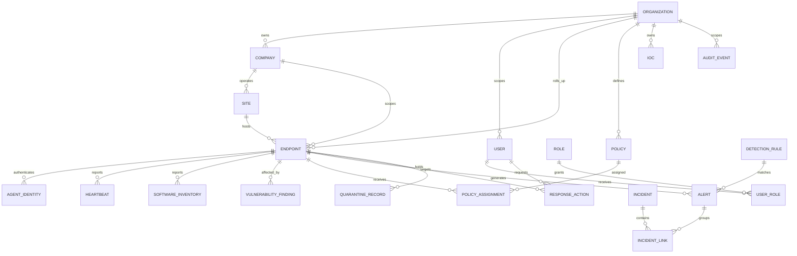

# Ariba EPP — Data Model and Retention Contract

**Status:** Draft logical model; schema is not approved/implemented.  
**Candidate transactional database:** PostgreSQL. **Candidate event search:** OpenSearch.

## 1. Data ownership and storage boundaries

| Data | Source of truth | Notes |
|---|---|---|
| Organizations/companies/sites/users/role assignments | PostgreSQL | Multi-tenant, multi-company control-plane data |
| Endpoint identity, inventory and health | PostgreSQL | Hierarchy-scoped (org/company/site); heartbeat history retention TBD |
| Policy definitions/versions/assignments | PostgreSQL + signed bundle reference | Never trust unsigned agent-facing policy |
| Detection-rule metadata and alert workflow | PostgreSQL | Keep rule version and evidence reference |
| High-volume raw/normalized telemetry | OpenSearch or selected event store | Retention, partition and tenant isolation required |
| Quarantined files/forensic artifacts | Restricted object storage | Avoid arbitrary file storage in relational DB |
| Cache/temporary coordination | Redis | Not durable source of truth |
| Credentials/private keys | External secret/certificate service where available | DB stores IDs/hashes/metadata only; never plaintext secrets |

## 2. Logical entities (Corporate Group Hierarchy)

This ER sketch includes future entities for discussion. `INCIDENT` is optional pending ADR-017; response/quarantine entities are Release 2 and remain gated by ADR-014/action approval. A diagram entity alone is not feature approval.

## 3. Entity contract

| Entity | Key fields | Required invariants |
|---|---|---|
| Organization | ID, code, name, status, timestamps | Stable corporate group / parent tenant boundary (e.g. Akij Group) |
| Company | ID, organization ID, code, name, industry_type, status | Business entity/subsidiary belonging to exactly one Organization (e.g. Akij Plastic) |
| Site | ID, organization ID, company_id, code, name, site_type | Operating unit (Factory, Office, Depot, Branch) belonging to one Company |
| User | ID, email, full_name, password_hash, mfa status | Platform identity; authenticated subject |
| Role / Permission / UserRole | Role name, permission code, scope type/ID, grantor, validity | Proposed hierarchical grants at Platform/Group/Company/Site; effective grants wait for owner/security approval of [PERMISSION-MATRIX.md](../security/PERMISSION-MATRIX.md) |
| Endpoint | ID, organization_id, company_id, site_id, hostname, platform, OS/agent version, status, last seen | Proposed denormalized hierarchy IDs for direct scope checks/rollups; validate referential consistency and query performance before adoption; unique per (company_id, hostname) |
| AgentIdentity | Endpoint ID, cert/key reference, serial, issued/expiry/revoked | No reusable fleet credential; secrets not persisted in plaintext |
| Heartbeat | Endpoint ID, received/reported time, health, agent/policy version | Server timestamp authoritative for received time |
| SoftwareInventory | Endpoint ID, package identity/version/source/time | Data collection and retention/privacy approval required |
| VulnerabilityFinding | Endpoint ID, software identity/version, CVE/source ID, severity, status, detected/updated time | Provenance and source timestamp retained; deduplicated per endpoint/software/CVE; never presented as a patch guarantee |
| Policy / Assignment | Organization ID, optional Company/Site scope, version, config hash, signature ref, status | Immutable version record; assignment tracks ack/rejection; hierarchy precedence/conflict rules To confirm |
| DetectionRule | Rule ID/version, severity, platform, required schema, provenance, tests | Disabled until validated; every version traceable |
| Alert | Tenant, endpoint, rule/version, status, severity, timestamps, evidence refs | State changes and assignment audited |
| Incident (if approved) | Tenant, owner, priority, status, linked alerts | Separate case entity/lifecycle is To confirm; do not implement from the draft entity alone |
| ResponseAction | Tenant, endpoint, type, target, requester, approver, expiry, result | Idempotent, deny-by-default, immutable audit linkage |
| IOC | Type/value/source/confidence/created/expiry | Normalize and track provenance; privacy/license review |
| QuarantineRecord | Endpoint, object reference/hash, status, retention, actor | Object restricted, integrity checked, restore path defined |
| AuditEvent | Tenant, actor, action, object, time, outcome, request ID | Append-only/tamper-evident design; secrets excluded |

## 4. Multi-Tenant, Multi-Company Isolation Rules

**Approved product model:** Centrally hosted platform with **Platform ➔ Organization (Parent Group) ➔ Company (Business Entity) ➔ Site (Unit/Factory/Office) ➔ Endpoint (Asset)**. This is five levels when the platform boundary is counted, or four customer-data levels below the platform.

- Every company belongs to a parent `organization_id`. Every site belongs to a `company_id`.
- The current proposal stores `organization_id`, `company_id`, and `site_id` on endpoint records for direct scope checks and rollups. This denormalization is not yet a performance claim: validate referential integrity, indexes, query plans and write/update consistency before implementation.
- **Hierarchical Authorization:**
  - `platform_super_admin`: Platform administration; raw customer telemetry/files are not routine access.
  - `group_admin` / `group_soc_lead`: Proposed parent-Group scope; exact grants are pending the permission-matrix approval.
  - `company_admin` / `company_soc_analyst`: Proposed Company scope; cross-Company access is denied.
  - `site_admin`: Proposed local `site_id` scope; endpoint/token/health permissions remain To confirm.
- Proposed unique constraints should be evaluated at appropriate boundaries (e.g., `UNIQUE(organization_id, code)` for companies; `UNIQUE(company_id, hostname)` for endpoints); final rules require migration/rename/reuse analysis.
- Cross-Group access is denied. Company-scoped roles cannot access sibling Companies. Group-level rollups are available only through explicit aggregate permissions and must not expose Company-level details without an additional grant. Site scope is always enforced.
- Read, update, delete, search, export and response paths enforce hierarchical scoping server-side.
- PostgreSQL Row-Level Security (RLS) on `organization_id` and `company_id` is a candidate defense in depth; selection is pending ADR-010.
- Cross-Group and out-of-scope Site negative tests are mandatory. Sibling-Company tests must prove Company-scoped roles are denied while Group-scoped access returns only explicitly permitted rollup data or details.

## 5. Retention and privacy

Retention is **To confirm** before pilot. Create a data inventory with field, purpose, source, sensitivity, collection toggle, tenant scope, retention, deletion method, access role and audit behavior. In particular decide:

- Whether assigned user, full command line, file path, IP/MAC and process lineage are collected.
- Raw telemetry retention versus alert/evidence retention.
- Quarantine/evidence retention and secure deletion.
- Tenant export/deletion and legal hold behavior.
- Data residency and backup retention.

Until approved, collect only minimum synthetic lab data. Avoid personal/customer endpoint telemetry in development fixtures.

## 6. Migration, integrity and recovery requirements

- Schema changes are versioned migrations with forward validation and tested restore/rollback procedure.
- Use foreign keys, explicit nullability, enumerated/state validation and tenant-scoped indexes.
- Apply encryption at rest according to deployment/key-management decision; restrict DB service accounts.
- Backups are encrypted, access controlled and periodically restore-tested.
- Audit events and policy/rule versions have integrity/provenance controls.
- Raw event store retention/rollover must be tested under representative volume.
- Define deletion propagation across PostgreSQL, search, object storage, backups and exports.

## 7. Database acceptance checklist

- Migrations can build the schema from a clean database and upgrade from the prior supported version.
- Cross-tenant access tests fail closed at app and relevant storage boundaries.
- No plaintext passwords, certificates, private keys, reusable agent secrets or raw secret material are stored.
- Retention/deletion and restore behavior are documented before customer data is accepted.
- High-volume telemetry is not written unbounded to PostgreSQL.
- Backup restore recovers tenant relationships and preserves audit/integrity expectations.