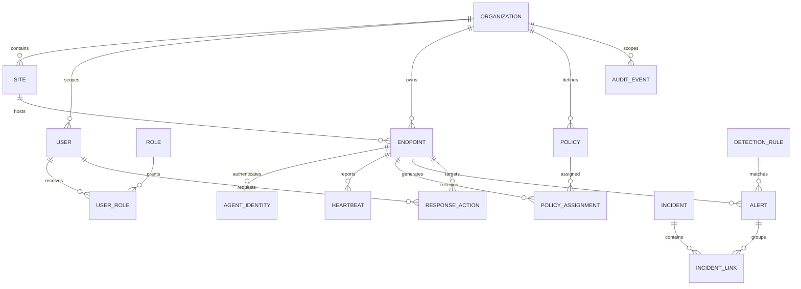

# Ariba EPP — Data Model and Retention Contract

**Status:** Draft logical model; schema is not approved/implemented.  
**Candidate transactional database:** PostgreSQL. **Candidate event search:** OpenSearch.

## 1. Data ownership and storage boundaries

| Data | Source of truth | Notes |
|---|---|---|
| Organizations/sites/users/role assignments | PostgreSQL | Tenant/control-plane data |
| Endpoint identity, inventory and health | PostgreSQL | Tenant-scoped; heartbeat history retention TBD |
| Policy definitions/versions/assignments | PostgreSQL + signed bundle reference | Never trust unsigned agent-facing policy |
| Detection-rule metadata and alert workflow | PostgreSQL | Keep rule version and evidence reference |
| High-volume raw/normalized telemetry | OpenSearch or selected event store | Retention, partition and tenant isolation required |
| Quarantined files/forensic artifacts | Restricted object storage | Avoid arbitrary file storage in relational DB |
| Cache/temporary coordination | Redis | Not durable source of truth |
| Credentials/private keys | External secret/certificate service where available | DB stores IDs/hashes/metadata only; never plaintext secrets |

## 2. Logical entities

## 3. Entity contract

| Entity | Key fields | Required invariants |
|---|---|---|
| Organization | ID, name, status, timestamps | Stable tenant boundary |
| Site | ID, organization ID, name, type | Site belongs to exactly one organization |
| User | ID, identity-provider subject/email reference, status | Do not store plaintext password; identity provider decision TBD |
| Role / UserRole | Role key, scope, grantor, time | Server-enforced least privilege; audit grants/revokes |
| Endpoint | ID, organization/site, hostname, platform, OS/agent version, status, last seen | Every query scoped by organization; hostname uniqueness policy TBD |
| AgentIdentity | Endpoint ID, cert/key reference, serial, issued/expiry/revoked | No reusable fleet credential; secrets not persisted in plaintext |
| Heartbeat | Endpoint ID, received/reported time, health, agent/policy version | Server timestamp authoritative for received time |
| SoftwareInventory | Endpoint ID, package identity/version/source/time | Data collection and retention/privacy approval required |
| Policy / Assignment | Organization ID, version, config hash, signature ref, scope, status | Immutable version record; assignment tracks ack/rejection |
| DetectionRule | Rule ID/version, severity, platform, required schema, provenance, tests | Disabled until validated; every version traceable |
| Alert | Tenant, endpoint, rule/version, status, severity, timestamps, evidence refs | State changes and assignment audited |
| Incident | Tenant, owner, priority, status, linked alerts | Access controlled and lifecycle audited |
| ResponseAction | Tenant, endpoint, type, target, requester, approver, expiry, result | Idempotent, deny-by-default, immutable audit linkage |
| IOC | Type/value/source/confidence/created/expiry | Normalize and track provenance; privacy/license review |
| QuarantineRecord | Endpoint, object reference/hash, status, retention, actor | Object restricted, integrity checked, restore path defined |
| AuditEvent | Tenant, actor, action, object, time, outcome, request ID | Append-only/tamper-evident design; secrets excluded |

## 4. Tenant isolation rules

- Every tenant-owned row has a non-null `organization_id` directly or through a verified parent relation.
- Service authorization uses authenticated principal scope; never trust submitted tenant IDs.
- Unique constraints include tenant scope when identifiers are not globally unique.
- Read, update, delete, export, search and async-worker paths all enforce tenant scope.
- Consider PostgreSQL Row-Level Security as defense in depth; it does not replace service authorization or test coverage.
- Search indices, object storage paths/metadata, caches and broker messages must carry and validate tenant context.
- Add cross-tenant negative tests for each API and worker query pattern.

## 5. Retention and privacy

Retention is **To confirm** before pilot. Create a data inventory with field, purpose, source, sensitivity, collection toggle, tenant scope, retention, deletion method, access role and audit behavior. In particular decide:

- Whether assigned user, full command line, file path, IP/MAC and process lineage are collected.
- Raw telemetry retention versus alert/evidence retention.
- Quarantine/evidence retention and secure deletion.
- Tenant export/deletion and legal hold behavior.
- Data residency and backup retention.

Until approved, collect only minimum synthetic lab data. Avoid personal/customer endpoint telemetry in development fixtures.

## 6. Migration, integrity and recovery requirements

- Schema changes are versioned migrations with forward validation and tested restore/rollback procedure.
- Use foreign keys, explicit nullability, enumerated/state validation and tenant-scoped indexes.
- Apply encryption at rest according to deployment/key-management decision; restrict DB service accounts.
- Backups are encrypted, access controlled and periodically restore-tested.
- Audit events and policy/rule versions have integrity/provenance controls.
- Raw event store retention/rollover must be tested under representative volume.
- Define deletion propagation across PostgreSQL, search, object storage, backups and exports.

## 7. Database acceptance checklist

- Migrations can build the schema from a clean database and upgrade from the prior supported version.
- Cross-tenant access tests fail closed at app and relevant storage boundaries.
- No plaintext passwords, certificates, private keys, reusable agent secrets or raw secret material are stored.
- Retention/deletion and restore behavior are documented before customer data is accepted.
- High-volume telemetry is not written unbounded to PostgreSQL.
- Backup restore recovers tenant relationships and preserves audit/integrity expectations.